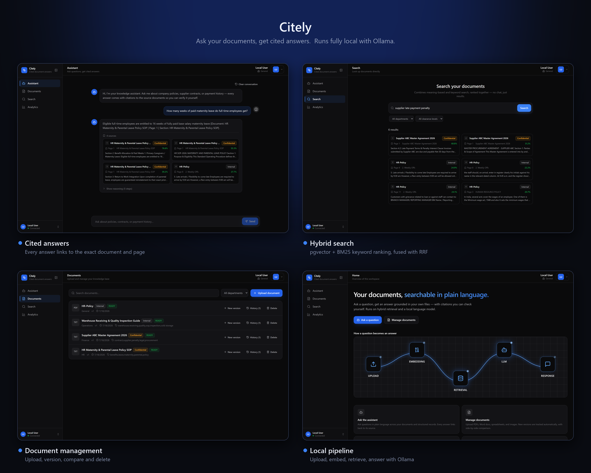

<div align="center">

# Citely

**Ask your documents, get cited answers.**

A private, fully local document assistant. Upload your files, ask questions in plain language,<br>
and get answers that link back to the exact document and page.




</div>

## Features

- **Cited answers.** Every answer names the document, page and section it came from, so you can check it.
- **Hybrid search.** Combines meaning-based vector search (pgvector) with keyword search (BM25).
- **Runs locally.** The LLM runs on your machine through Ollama. No API keys, and your files never leave your PC.
- **Many file types.** PDF, Word, PowerPoint, Excel, CSV, text, Markdown, and images (with OCR).
- **Versioning.** Upload a new version of a document and compare it with the old one. The old version stays searchable until the new one is ready.
- **Saved conversations.** Chat history is stored in the database and survives restarts.
- **Analytics.** See which documents are searched most, response times, and recent questions.

## How it works

```text
Upload ──► Extract text ──► Split into chunks ──► Embed ──► pgvector
                                                              │
Question ──► Vector search + keyword search ──► Rank ◄────────┘
                                                  │
                                    Top chunks ──► Local LLM ──► Answer with citations
```

Documents are processed in the background by a Celery worker. When you ask a question, Citely finds the most relevant passages, then the local LLM writes an answer using only those passages.

## Tech stack

| Part | Built with |
| :-- | :-- |
| Backend | FastAPI, SQLAlchemy (async), Celery + Redis |
| Database | PostgreSQL 16 with pgvector |
| AI | Ollama (local LLM), Sentence Transformers (`all-MiniLM-L6-v2`), BM25 |
| Documents | PyMuPDF, python-docx, python-pptx, openpyxl, Tesseract OCR |
| Frontend | Next.js 14, TypeScript, Tailwind CSS |

## Getting started

### Requirements

- Python 3.10+ and Node.js 18+
- PostgreSQL 16 with the [pgvector](https://github.com/pgvector/pgvector) extension, and Redis
- [Ollama](https://ollama.com) with a model pulled, for example `ollama pull gemma3:4b`
- Optional: [Tesseract](https://github.com/tesseract-ocr/tesseract) for scanned PDFs and images

### Setup

```bash
git clone https://github.com/LikithGS11/citely-local.git
cd citely-local
cp .env.example .env          # then edit the values if needed

# Backend
cd backend
python -m venv venv
venv\Scripts\activate         # macOS/Linux: source venv/bin/activate
pip install -r requirements.txt

# Frontend
cd ../frontend
npm install
```

### Run

**Windows:** double-click `RAG Launcher.bat`. It starts every service and opens the app.

**Manually**, in three terminals:

```bash
# 1. API
cd backend && uvicorn app.main:app --host 127.0.0.1 --port 8000

# 2. Background worker (on Windows, add: -P solo)
cd backend && celery -A app.core.celery_app worker --loglevel=info

# 3. Frontend
cd frontend && npm run dev
```

Open **<http://localhost:3000>**. To check that everything is connected, open <http://localhost:8000/health>.

## Configuration

All settings live in `.env` in the project root. The main ones:

| Variable | Default | What it does |
| :-- | :-- | :-- |
| `OLLAMA_MODEL` | `gemma3:4b` | Which local model answers questions |
| `OLLAMA_NUM_CTX` | `8192` | How much text the model can read at once |
| `EMBEDDING_MODEL` | `all-MiniLM-L6-v2` | Model used to embed documents |
| `POSTGRES_*`, `REDIS_*` | `127.0.0.1` | Database and queue connection |
| `CORS_ORIGINS` | `localhost:3000` | Which web pages may call the API |

See [`.env.example`](.env.example) for the full list.

## Project structure

```text
backend/
  app/ai/          retrieval, embeddings, LLM, question routing
  app/api/v1/      REST endpoints: documents, chat, search, analytics
  app/services/    file parsing and chunking
  app/tasks/       background ingestion jobs
  tests/           pytest suite
frontend/src/      Next.js pages and components
launcher.py        one-click start/stop app for Windows
```

## Testing

```bash
cd backend
pip install -r requirements-dev.txt
pytest
```

## Good to know

- **No login.** Citely is built for one person on their own computer. Don't expose it to a network.
- **Changing the embedding model** means re-uploading your documents.
- **Word files** have no fixed pages, so their citations point to the section heading instead.

## License

[MIT](LICENSE)
